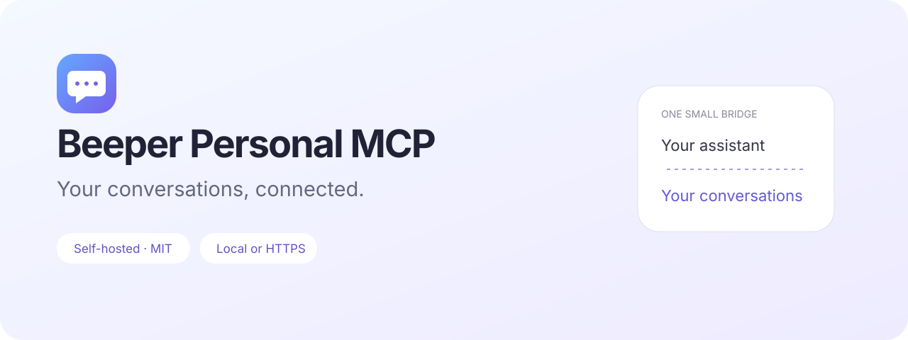

<p align="center"></p>

<p align="center">
<a href="https://edouaz.github.io/beeper-personal-mcp/">Website & brand kit</a> · <a href="LICENSE">MIT license</a> · <a href="docs/INSTALL.md">Installation</a> · <a href="docs/CAPABILITIES.md">Capabilities</a> · <a href="CONTRIBUTING.md">Contributing</a>
</p>

A personal, self-hosted [Model Context Protocol](https://modelcontextprotocol.io/) gateway for [Beeper](https://developers.beeper.com/). Connect an assistant to the conversations already in your Beeper account: search, catch up, read attachments, and send messages with your approval.

**Independent community project. Not affiliated with Beeper or Apple.** Pre-release; one owner per installation. Your instance stays private even though this code is public. The [GitHub Pages website](https://edouaz.github.io/beeper-personal-mcp/) introduces the project and offers a downloadable logo kit.

## Start here

You need **Node.js 20.19+ with npm**, Git, and a Beeper account. Linux x86_64 is the validated deployment platform. The gateway is portable Node.js; the CLI and Beeper Server depend on their own OS support. Native Windows is not supported by the shell wrapper; use Linux/WSL.

```sh
git clone https://github.com/edouaz/beeper-personal-mcp.git
cd beeper-personal-mcp
./bin/setup
```

`./bin/setup` installs, configures and starts the project; on later runs use `npm start`. The setup assistant installs the gateway dependencies and runs the official Beeper CLI to install, sign in and verify your Beeper Server. It creates private credentials under `state/`. No manual `.env` editing is needed for a new installation. Your email/device verification still requires your participation.

Choose your connection:

| Mode | Best for | What you need |
| --- | --- | --- |
| `local` (default) | A local MCP client using HTTP and a bearer token; read tools | Nothing public; binds to `127.0.0.1` |
| `openai` | Private ChatGPT connection, without Cloudflare, a public hostname or app OAuth | Official `tunnel-client`, OpenAI tunnel permissions + runtime key ([guide](docs/OPENAI-TUNNEL.md)) |
| `tunnel` | Trying ChatGPT over HTTPS with OAuth and approved sends | [cloudflared](https://developers.cloudflare.com/tunnel/downloads/); temporary hostname |
| `remote` | An always-on instance with a stable HTTPS address | Your own domain + Caddy or a named Cloudflare Tunnel |

```sh
./bin/setup --mode openai                         # private OpenAI tunnel; no app OAuth
./bin/setup --mode tunnel                         # temporary HTTPS; install cloudflared first
./bin/setup --mode remote --url https://mcp.example.com
npm run doctor                                   # local readiness checks
node cli/index.mjs connection                     # PRIVATE local client config, shown in terminal
./bin/beeper status                              # official Beeper CLI, isolated project state
```

Run **one** setup variant in a fresh checkout. For public remote and Cloudflare tunnel modes, save the owner password shown once by setup. The command launches the service; use `npm start` for subsequent launches. Public HTTP modes print an HTTPS MCP URL for OAuth; OpenAI mode prints the tunnel connection instructions. Availability of custom MCP connections depends on your client/account. See the [complete installation guide](docs/INSTALL.md), including client settings, stable tunnels, services, updates and migration.

Temporary tunnels change address on every start and are for development. This gateway uses JSON HTTP responses rather than SSE, which Quick Tunnels do not support. A remote ChatGPT connection cannot reach your computer’s localhost.

## What it does

- Search accounts, chats, contacts and messages; get unread conversations and resumable exports.
- Read bounded image/PDF attachments without giving the assistant arbitrary filesystem access.
- Use OAuth with PKCE, scoped access and owner approval for remote connections.
- Prepare a message for approval on a protected page before a single send attempt. Advanced direct-send mode is opt-in.
- Report `pending`, `sent`, `delivered`, `read` or `failed` from available evidence. An accepted send is not a delivery receipt.
- Support reactions, drafts, chat state, edit/delete and WhatsApp find-or-open where the connected network supports them; availability depends on the authorization mode.

See [capabilities and test coverage](docs/CAPABILITIES.md). Local bearer mode exposes read tools and a local draft helper. Public HTTP writes require OAuth. Private OpenAI stdio mode offers direct writes only after an explicit opt-in; access is controlled by tunnel permissions. No bulk messaging, auto-replies or automatic send retries.

## How it fits together

```text
Local client ── bearer token ──┐
                              ├─ MCP gateway (127.0.0.1) ── Beeper Server ── your networks
ChatGPT ── HTTPS + OAuth ──────┘
           Caddy or tunnel

ChatGPT ── private OpenAI tunnel ── stdio gateway ── Beeper Server
```

The public code never includes your Beeper credentials, conversations, OAuth state or server binary. All runtime state belongs to you in `state/`. The optional [event forwarder](mcp/EVENTS.md) and [plugin integration generator](plugin-integration/README.md) are included but not enabled by setup.

## Development

```sh
npm ci
npm --prefix mcp ci
npm run check
npm test
```

Tests use mocks and a fake Beeper server. They do not access your account or send real messages. Live checks are separately gated; see [CONTRIBUTING.md](CONTRIBUTING.md). CI checks syntax, tests, dependency audits and accidental private files on Node 20, 22 and 24.

## Privacy, limits and license

Read the [security model](docs/SECURITY-MODEL.md) and [security policy](SECURITY.md). Keep `state/` private and back it up securely. Public HTTP OAuth callbacks currently support **ChatGPT only**. Private OpenAI tunnels use stdio with no app-level OAuth. Other local clients can use the bearer mode; the HTTP configuration format depends on the client. The CLI, website, documentation and approval pages use English by default. Duplicate/rate protections are in memory and reset at restart. One owner per instance; this is not a multi-user SaaS.

[MIT](LICENSE) applies to this repository. Beeper Server is proprietary software downloaded from Beeper by its official CLI; it is not redistributed here. Beeper, Apple and network names belong to their respective owners. The visual identity uses original artwork; see [brand notes](docs/BRAND.md).

[Troubleshooting](docs/TROUBLESHOOTING.md) · [Changelog](CHANGELOG.md) · [Contributing](CONTRIBUTING.md)
